# Entity-Relationship Diagram — Fish Farm Management System (FMS)

> Version 1.0 · 2026-07-07 · Derived from `GLOSSARY.md §2` (canonical entities), `contracts/
> openapi.yaml` (field-level schemas, CON-001…CON-048), `DECISIONS.md` (ADR-006/007/008/013/016/018),
> and `BACKLOG.md` (per-task table ownership). This is the **full v1+v2+v3 data model** — 30 tables
> across MOD-01…MOD-12 (24 business entities + 6 platform/shared-kernel tables, see the note under
> §2 — `DELIVERY_ATTEMPT` added TASK-016) — P1/P2/P3 priority is noted per entity so implementation order
> still follows `BACKLOG.md`. **Not a new phase artifact** in the Phase 0–7 cascade; a supplementary
> reference kept in sync as modules land. Update it whenever a migration changes shape.

---

## 1. Conventions (apply to every table)

- **Tenant isolation (ADR-006, NFR-011):** every project-owned table carries an indexed `project_id`
  — even where the row is reachable via `pond_id`/`batch_id` — because the scoped-repository base
  filters on it uniformly and cheaply. Shown explicitly on each entity below.
- **IDs (ADR-016):** all primary keys are `UUID v4`, mintable offline by the mobile client.
- **Money (ADR-013, ADR-018):** stored as **integer minor units** (`amount_minor`, poisha for BDT) or
  `decimal`; **never float**. Currency is **BDT only** — no multi-currency/FX (ADR-018 supersedes the
  original "currency per project" idea; the `currency` column is retained for forward-compatibility
  but is not user-editable in v1).
- **Time:** UTC timestamps (`timestamptz`) in storage; Bangla dates are a display-only conversion via
  `packages/calendar` (ADR-011), never stored.
- **Land unit (ADR-018):** `Project.land_unit` defaults to `BIGHA` (enum `DECIMAL`/`KATHA`/`BIGHA`
  also selectable); `Pond.area` is always stored as a plain decimal in the project's unit.
- **TypeORM mapping (ADR-007):** every project-owned entity below extends
  `BaseProjectOwnedPersistenceModel` (`fish-farm-backend/src/platform/persistence`, built in
  TASK-002) — `id` + indexed `project_id` — then adds its own columns in its own module's
  `infrastructure/persistence/`.

---

## 2. Full ERD (Mermaid)

```mermaid
erDiagram
    USER ||--o{ PROJECT_MEMBERSHIP : holds
    PROJECT ||--o{ PROJECT_MEMBERSHIP : grants
    PROJECT ||--o{ POND : contains
    PROJECT ||--o{ INVENTORY_ITEM : stocks
    PROJECT ||--o{ FINANCIAL_TXN : records
    PROJECT ||--o{ CAMERA : has
    PROJECT ||--o{ TASK : defines
    PROJECT ||--o{ ALERT : raises
    PROJECT o|--o{ AUDIT_ENTRY : logs
    PROJECT ||--o| WEATHER_SNAPSHOT : "cached for"
    PROJECT ||--o{ WATER_THRESHOLD : configures

    SPECIES ||--o{ STOCKING : "stocked as"

    POND ||--o{ STOCKING : has
    POND ||--o{ WATER_READING : "monitored by"
    POND ||--o{ DEVICE : "installed at"
    POND ||--o{ POND_ACTION : "logged on"
    POND o|--o{ TASK : "optionally scopes"

    STOCKING ||--|| BATCH : creates

    BATCH ||--o{ SAMPLING : "measured by"
    BATCH ||--o{ MORTALITY : loses
    BATCH ||--o{ HARVEST : yields
    BATCH ||--o{ FEEDING_LOG : "fed by"
    BATCH ||--o{ TREATMENT : receives

    INVENTORY_ITEM ||--o{ FEEDING_LOG : "consumed in"
    INVENTORY_ITEM ||--o{ INVENTORY_TXN : "tracked by"

    TASK ||--o{ TASK_LOG : "completed as"

    DEVICE o|--o{ WATER_READING : ingests

    USER {
        uuid id PK
        string email UK
        string password_hash
        string name
        timestamptz created_at
    }

    PROJECT_MEMBERSHIP {
        uuid id PK
        uuid user_id FK
        uuid project_id FK "indexed"
        enum role "OWNER | WORKER | PARTNER"
        enum status "ACTIVE | REMOVED (TASK-010 gap synced back)"
        timestamptz created_at
    }

    PROJECT {
        uuid id PK
        string name
        decimal site_lat
        decimal site_lng
        string address
        string currency "BDT only (ADR-018)"
        enum land_unit "DECIMAL | KATHA | BIGHA, default BIGHA (ADR-018)"
        enum status "ACTIVE | CLOSED"
        timestamptz created_at
    }

    SPECIES {
        uuid id PK
        string name
        enum category "PRAWN | FISH"
        decimal default_density_min "per bigha, nullable"
        decimal default_density_max "per bigha, nullable"
    }

    POND {
        uuid id PK
        uuid project_id FK "indexed"
        string name
        decimal area "in project's land_unit"
        decimal depth_m
        string notes
        timestamptz created_at
    }

    STOCKING {
        uuid id PK
        uuid project_id FK "indexed"
        uuid pond_id FK
        uuid species_id FK
        enum source "HATCHERY | WILD | OTHER"
        string hatchery_name "nullable"
        int count
        date stocked_on
        int stocking_cost_minor "Money, BDT"
    }

    BATCH {
        uuid id PK
        uuid project_id FK "indexed"
        uuid pond_id FK
        uuid stocking_id FK, UK
        uuid species_id FK
        int initial_count
        int cumulative_mortality "derived/cached"
        int harvested_count "derived/cached (TASK-019 gap synced back)"
        decimal latest_avg_weight_g "nullable, from Sampling"
        enum status "ACTIVE | HARVESTING | CLOSED"
        date stocked_on
    }

    SAMPLING {
        uuid id PK
        uuid project_id FK "indexed"
        uuid batch_id FK
        int sample_size
        decimal avg_weight_g
        date sampled_on
        string client_mutation_id UK "offline idempotency"
    }

    MORTALITY {
        uuid id PK
        uuid project_id FK "indexed"
        uuid batch_id FK
        int count
        string cause_category
        string photo_url "nullable"
        timestamptz occurred_at
        string client_mutation_id UK "offline idempotency"
    }

    TREATMENT {
        uuid id PK
        uuid project_id FK "indexed"
        uuid batch_id FK
        string product
        string dose
        date administered_on
        int withdrawal_days
        date export_safe_after "derived"
    }

    HARVEST {
        uuid id PK
        uuid project_id FK "indexed"
        uuid batch_id FK
        int quantity
        decimal total_weight_kg
        enum grade "EXPORT | LOCAL"
        date harvested_on
        int revenue_minor "Money, BDT, nullable"
    }

    INVENTORY_ITEM {
        uuid id PK
        uuid project_id FK "indexed"
        string name
        enum feed_type "FLOATING | SINKING | NURSERY_DUST, nullable"
        string unit "e.g. kg"
        decimal quantity "cached balance"
        decimal low_stock_threshold
    }

    INVENTORY_TXN {
        uuid id PK
        uuid project_id FK "indexed"
        uuid item_id FK
        decimal delta "positive=receipt, negative=deduction/adjustment"
        string reason
        int cost_minor "nullable, Money BDT (TASK-020 gap synced back, AC-082/R8)"
        timestamptz occurred_at
    }

    FEEDING_LOG {
        uuid id PK
        uuid project_id FK "indexed"
        uuid batch_id FK
        uuid inventory_item_id FK
        decimal qty_kg
        enum observation "NORMAL | LEFTOVER | EMPTY, nullable"
        timestamptz fed_at
        string client_mutation_id UK "offline idempotency"
    }

    WATER_READING {
        uuid id PK
        uuid project_id FK "indexed"
        uuid pond_id FK
        enum parameter "DO|TEMP|PH|AMMONIA|NITRITE|ALKALINITY|SECCHI"
        decimal value
        enum source "MANUAL | SENSOR"
        uuid device_id FK "nullable"
        timestamptz read_at
        string client_mutation_id UK "offline idempotency"
    }

    WATER_THRESHOLD {
        uuid id PK
        uuid project_id FK "indexed"
        enum parameter
        decimal min_value "nullable"
        decimal max_value "nullable"
        decimal critical_value "nullable"
    }

    POND_ACTION {
        uuid id PK
        uuid project_id FK "indexed"
        uuid pond_id FK
        enum action_type "CHAIN_DRAG | AERATION"
        timestamptz performed_at
        string notes "nullable"
        string client_mutation_id UK "offline idempotency"
    }

    DEVICE {
        uuid id PK
        uuid project_id FK "indexed"
        uuid pond_id FK
        string device_key_hash "hashed, never plaintext"
        string label
        timestamptz registered_at
    }

    TASK {
        uuid id PK
        uuid project_id FK "indexed"
        uuid pond_id FK "nullable"
        string title
        int recurrence_days "nullable = one-off"
        enum status "SCHEDULED | DUE | DONE | MISSED"
        date due_on
    }

    TASK_LOG {
        uuid id PK
        uuid project_id FK "indexed"
        uuid task_id FK
        timestamptz completed_at
        string photo_url "nullable"
        string client_mutation_id UK "offline idempotency"
    }

    FINANCIAL_TXN {
        uuid id PK
        uuid project_id FK "indexed"
        enum kind "COST | REVENUE"
        enum category "FEED|SALARY|MEDICINE|STOCKING|EQUIPMENT|MISC|HARVEST"
        int amount_minor "Money, BDT"
        date occurred_on
        string source_ref "nullable, idempotent event ingestion key"
        string note "nullable"
    }

    CAMERA {
        uuid id PK
        uuid project_id FK "indexed"
        string rtsp_url "server-side only, never sent to client"
        string stream_url "derived HLS/WebRTC URL"
        enum protocol "HLS | WEBRTC"
        boolean online
    }

    WEATHER_SNAPSHOT {
        uuid project_id PK "1:1 cache row per project, also FK to Project"
        decimal temp_c
        string condition
        boolean heavy_rain
        boolean extreme_heat
        timestamptz fetched_at
        boolean stale
    }

    ALERT {
        uuid id PK
        uuid project_id FK "indexed"
        enum type "WATER_THRESHOLD|WATER_EMERGENCY|LOW_STOCK|MISSED_TASK|ABNORMAL_MORTALITY"
        enum severity "INFO | WARNING | CRITICAL"
        enum state "RAISED | SENT | ACKNOWLEDGED | RESOLVED"
        string message
        string source_ref "what triggered it — pond/item/task/batch id (TASK-015 gap synced back)"
        string dedup_key "idempotent re-raise guard, keyed by project+type+source_ref"
        timestamptz raised_at
        timestamptz acknowledged_at "nullable"
        timestamptz resolved_at "nullable (TASK-015 gap synced back)"
        timestamptz escalated_at "nullable, set once on SLA breach (TASK-017 gap synced back, R7)"
    }

    DEVICE_TOKEN {
        uuid id PK
        uuid user_id FK
        string fcm_token UK "unique — re-registration upserts, no duplicate pushes"
        enum platform "ANDROID | WEB"
        timestamptz registered_at
    }

    DELIVERY_ATTEMPT {
        uuid id PK
        uuid alert_id FK "indexed"
        enum channel "FCM | SMS | WHATSAPP (TASK-016 gap synced back — module doc §4.3 always had it)"
        enum status "SENT | FAILED"
        timestamptz attempted_at
        string error "nullable"
    }

    AUDIT_ENTRY {
        uuid id PK
        uuid project_id FK "indexed, nullable for platform-level actions"
        uuid actor_user_id FK "nullable - pre-auth platform actions have no actor"
        string action "route-shaped, e.g. POST /projects/:projectId/ponds"
        string entity_type
        uuid entity_id "nullable"
        timestamptz occurred_at "immutable, append-only"
        jsonb metadata "nullable, e.g. route params"
    }

    PASSWORD_RESET_TOKEN {
        uuid id PK
        uuid user_id FK
        string token_hash
        timestamptz expires_at
        timestamptz used_at "nullable"
    }

    REFRESH_TOKEN {
        uuid id PK
        uuid user_id FK
        string family_id "rotation family"
        string token_hash
        timestamptz expires_at
        timestamptz revoked_at "nullable"
    }

    SYNC_MUTATION {
        string client_mutation_id PK
        uuid project_id FK "indexed"
        uuid user_id FK
        string entity
        string status "SYNCED | CONFLICT | FAILED"
        timestamptz processed_at
    }
```

> `DEVICE_TOKEN`, `DELIVERY_ATTEMPT`, `AUDIT_ENTRY`, `PASSWORD_RESET_TOKEN`, `REFRESH_TOKEN`,
> `SYNC_MUTATION` are platform/shared-kernel tables (MOD-01/02/09/12) — included for completeness though they aren't
> "business" entities in the BRD sense. `AUDIT_ENTRY.project_id` is nullable because a few
> platform-level actions (e.g. login) are not scoped to a project.

---

## 3. Entity → owning module → priority

| Entity | Module | Priority | Delivering task(s) |
|---|---|---|---|
| User, PasswordResetToken, RefreshToken | MOD-02 | P1 | TASK-008, TASK-009 |
| ProjectMembership | MOD-02 | P1 | TASK-010 |
| Project | MOD-03 | P1 | TASK-011 |
| Pond | MOD-04 | P1 | TASK-018 |
| Species | MOD-04 | P1 | TASK-018 (seeded reference) |
| Stocking, Batch | MOD-04 | P1 | TASK-019 |
| Sampling | MOD-07 | P1 (record) / P2 (analytics) | TASK-029 |
| Mortality | MOD-07 | P1 | TASK-028 |
| Treatment | MOD-07 | P2 | TASK-028 |
| Harvest | MOD-07 | P2 | TASK-031 |
| InventoryItem, InventoryTxn | MOD-05 | P1 | TASK-020 |
| FeedingLog | MOD-05 | P1 | TASK-022 |
| WaterReading, WaterThreshold | MOD-06 | P1 | TASK-023 |
| PondAction | MOD-06 | P1 | TASK-025 |
| Device | MOD-06 | P3 | TASK-027 |
| Task, TaskLog | MOD-12 | P1 | TASK-041, TASK-044 |
| FinancialTxn | MOD-08 | P2 | TASK-032 |
| Camera | MOD-10 | P2 | TASK-035 |
| WeatherSnapshot | MOD-10 | P2 | TASK-036 |
| Alert | MOD-09 | P1 | TASK-015 |
| DeviceToken (FCM) | MOD-09 | P1 | TASK-016 |
| AuditEntry | MOD-01 | P1 | TASK-005 |
| SyncMutation | MOD-12 | P1 | TASK-040 |

---

## 4. Design notes tied to specific ADRs

- **Isolation boundary (ADR-006):** `Project` is the root of every ownership chain. `Pond`,
  `InventoryItem`, `FinancialTxn`, `Camera`, `Task`, `Alert`, `AuditEntry`, `WeatherSnapshot`,
  `WaterThreshold` hang off it directly; `Stocking`/`Batch`/`Sampling`/`Mortality`/`Harvest`/
  `FeedingLog`/`WaterReading`/`PondAction`/`Device` reach it via `Pond` or `Batch` — but **every one
  of them still carries its own indexed `project_id`** (denormalized on purpose, ADR-007) so the
  scoped-repository base never needs a join to enforce isolation.
- **Batch ↔ Stocking (1:1, ADR none — POND-3 in BRD):** each `Stocking` event creates exactly one
  `Batch`; the FK is unique. Cumulative mortality and latest sampling weight are **cached/derived**
  on `Batch` (maintained by idempotent event handlers per ADR-015 — `MortalityRecorded`,
  `SamplingRecorded`, `HarvestRecorded`), not recomputed from scratch per FCR/biomass query.
  `FCR` (Group G) is intentionally **not** a stored column — it's computed at read time, pond-level
  only (RISK-007 mitigation), never faked per-species.
- **Money (ADR-013 + ADR-018):** `stocking_cost`, `revenue`, `FinancialTxn.amount` are all
  `*_minor` integer columns. No `Currency` table — BDT is the only supported currency in v1.
- **Offline idempotency (ADR-010):** `client_mutation_id` (unique) appears on every entity a
  worker can create offline (`Mortality`, `FeedingLog`, `WaterReading`, `TaskLog`, `Sampling`,
  `PondAction`) plus the `SyncMutation` ledger — this is what makes `POST /sync` replay-safe.
- **Camera secrets (ADR-012):** `Camera.rtsp_url` is a raw credential-bearing field that **never**
  leaves the backend; only the derived `stream_url` (HLS/WebRTC) is exposed via `CameraConfig`
  (CON-036).
- **No per-species FCR / no cross-project reach:** deliberately absent from the model — see
  RISK-007 and NFR-011.

---

## 5. What this ERD does NOT show

- Read-models / projections (e.g. biomass overview, portfolio summary) — those are computed views
  over the tables above, not separate persisted schemas (unless a module's detail file says
  otherwise, e.g. MOD-04's survival/biomass read-model, which is a *maintained cache on `Batch`*,
  not a new table). **Exception:** MOD-07 §4.3 persists a `pond_feed_accumulator`
  (`project_id`, `pond_id`, `total_feed_kg`) maintained cache for pond-level FCR — it is a
  projection (rebuildable from `FeedingLog`), so it is documented here rather than drawn as an
  entity above.
- Internal/server-only fields deliberately absent from client contracts: `Alert.dedup_key`
  (idempotent re-raise guard, backend-only) and `Camera.rtsp_url` (ADR-012). Their omission from
  `contracts/openapi.yaml` response schemas is intentional, not drift.
- `packages/shared` DTO/event contract shapes (e.g. `WaterThresholdBreached`) — those are
  in-process event payloads, not persisted rows.
- Any P3/deferred schema for camera recording (reserved CON-055) or aerator control.

---

*ERD.md — Fish Farm Management System. Supplementary reference (not a numbered AIDLC phase).
Keep in sync with `contracts/openapi.yaml` and each module's migrations as TASK-018…TASK-041 land.*
