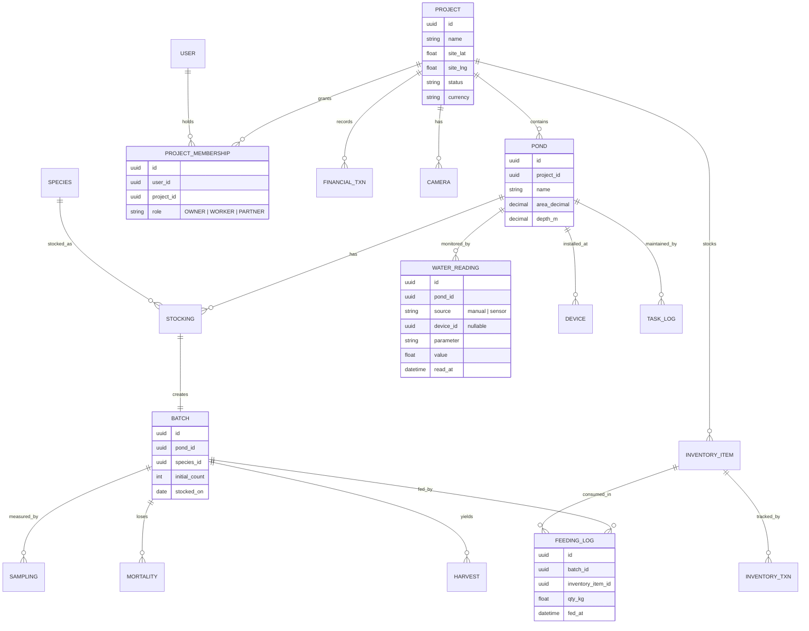
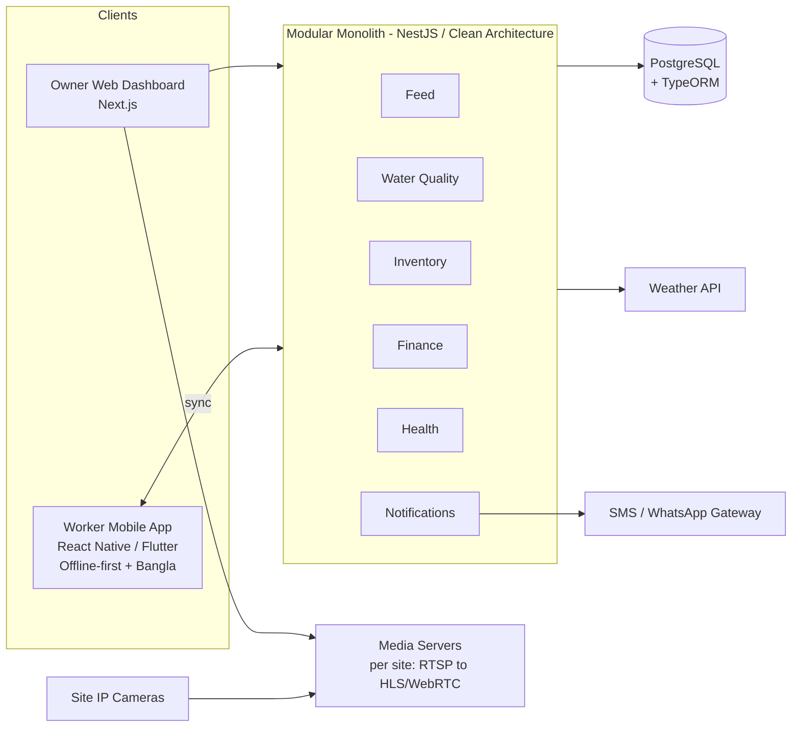

# Fish Farm Management System (FMS)
## Business Requirements & Functional Specification

---

### Document Control

| Field | Value |
|---|---|
| **Document title** | Polyculture Fish Farm Management System — BRD / SRS |
| **Version** | 3.1 (multi-project / multi-site + Bangla calendar) |
| **Status** | Draft for review |
| **Owner** | Portfolio Owner / Project Sponsor |
| **Context** | **Multiple** polyculture aquaculture projects (SPF Golda, Parse, Carp varieties) across **different sites**, Bangladesh. Each project is its own isolated unit; some are co-owned with partners. |
| **Prepared for** | Development against NestJS / Next.js / PostgreSQL / TypeORM stack |

**Change log**

| Version | Summary |
|---|---|
| 1.0 | Initial blueprint: dashboard, feed calculator, tasks, analytics, modular-monolith architecture |
| 2.0 | Added water-quality, pond/batch/stocking, health, and harvest modules; offline-first, localization, alerting, camera-infra requirements; scope phasing; data model; risks; acceptance criteria; KPIs; glossary |
| 3.0 | **Multi-project / multi-site model promoted to MVP:** Project as the tenant/isolation boundary; project-scoped RBAC with membership (Owner/Worker/Partner); per-project location, camera, weather, inventory, worker, and finances; portfolio dashboard; tenant-isolation NFR and data-leakage risk added. Stack confirmed on TypeORM. |
| 3.1 | Added **Bengali (Bangla) calendar** as a shared capability: Bangladesh-revised (2019) Gregorian↔Bangla conversion, Bengali numerals, dual-date display, and the six-season (ritu) mapping used for seasonal advisories. |

---

## 1. Executive Summary

The Fish Farm Management System (FMS) is a centralized platform to remotely operate **a portfolio of polyculture aquaculture projects** — each at its own site, raising **SPF Golda** (giant freshwater prawn), **Parse** (mullet), and **Carp** varieties. It lets a remote owner monitor and control every project from one place, while a per-site worker performs and logs daily tasks through a lightweight, offline-capable, Bangla-language mobile app.

Each **project is a self-contained unit** — its own location, stock cycle, feed inventory, worker, finances, and ROI — and access is scoped per project, so a partner who co-owns one project sees only that project. On top sits a **portfolio view** that rolls everything up and lets the owner drill into any single project.

The core value is a **single source of truth** that connects four things usually scattered across notebooks and phone calls: daily operations (feeding, water, mortality), stock and growth, finances, and live visual monitoring. The system's primary purpose is not record-keeping for its own sake — it is to **prevent stock loss** (water/oxygen events), **reduce feed waste** (the largest variable cost), and **make remote, multi-site management trustworthy** (verifiable logs and camera evidence, properly isolated per project).

---

## 2. Project Vision & Background

The owner manages the farm remotely and depends on an on-site worker for execution. Today this relies on memory, verbal updates, and manual calculation, which leads to feed waste, inconsistent water management, late reactions to problems, and no reliable financial picture until harvest. An existing IP camera provides some visibility but is not integrated with operations.

The FMS exists to convert this informal, trust-based operation into a measured one — without adding so much friction that the worker stops using it.

---

## 3. Goals & Objectives

| # | Objective | Target / KPI |
|---|---|---|
| G1 | Reduce feed waste via disciplined, species-specific feeding | Achieve and hold overall **FCR ≤ 1.5** |
| G2 | Prevent avoidable stock loss from water events | Maintain **survival rate ≥ 80%** per batch; zero un-alerted oxygen crashes |
| G3 | Make remote management reliable | 100% of critical daily tasks logged with timestamp; camera available on demand |
| G4 | Provide real-time financial visibility | Live net-profit and projected-ROI view, accurate to within recorded transactions |
| G5 | Optimize growth | Track **ADG / SGR** per species; hit target harvest weights on schedule |

> **Note on FCR in polyculture:** FCR is genuinely hard to attribute when multiple species share a pond and feed type. The system should compute FCR at the **pond level** (total feed in ÷ total biomass gain) and avoid implying false per-species precision unless feed is physically segregated.

---

## 4. Scope

### 4.1 In Scope
- **Multi-project / multi-site management** with a portfolio view and per-project drill-down
- **Project-scoped access control** (membership: Owner / Worker / Partner) with strict data isolation between projects
- Web admin dashboard (owner) and mobile worker app
- Pond, batch, and stocking management
- Feed calculation, scheduling, and inventory (per project)
- Water-quality monitoring and alerting
- Health, mortality, and treatment tracking
- Task scheduling and daily operations logging
- Sampling, growth analytics, and harvest management
- Financial tracking and ROI (per project + portfolio roll-up)
- Live camera and weather integration (per site)
- Notifications (push + SMS/WhatsApp)

### 4.2 Out of Scope (initial release)
- **Public SaaS / onboarding of unrelated third-party farms** — the system serves this owner's own portfolio, not arbitrary external tenants
- Automated hardware control (auto-feeders, IoT aerator switching) — see Phase 3
- Marketplace / buyer-facing sales features
- Accounting-grade financials (tax, payroll compliance) — lightweight expense tracking only
- Native desktop apps

### 4.3 Multi-Project Model (Tenancy)

The **Project** is the central organizing concept and the **isolation boundary** of the whole system.

- A **Project** = one aquaculture venture at one **site** (own location, camera, weather, feed inventory, worker, finances, ROI). It contains **one or more Ponds** (today typically one; the model allows growth without rework).
- Every operational and financial record is scoped to a project. Nothing blends across projects by accident.
- **Access is by membership, not global role.** A user holds a role *within* a project: **Owner** (you — member of all your projects, full access + portfolio view), **Worker** (one project, restricted operational access), **Partner** (a co-owned project, read-only including finances, sees only that project).
- Because partners can see some projects but not others, **cross-project isolation is a security requirement** (row-level), not a convenience — it is built into the foundation, not added later.

### 4.4 Phasing (this is the most important correction to v1.0)

The original blueprint labelled everything "MVP." That is too much for a first release and risks a worker app that's never adopted. Recommended sequencing:

**Phase 1 — Core operations (MVP).** The stuff that prevents loss and waste.
- **Project & membership setup, project-scoped access, tenant isolation** (foundational — partners depend on it)
- Pond / batch / stocking setup (under a project)
- Feed calculator + schedules + inventory deduction (per project)
- Daily worker log (feed, mortality, water observation) — **offline-first, Bangla**
- Water-quality logging + threshold alerts
- Basic task reminders
- Portfolio dashboard + per-project biomass overview

**Phase 2 — Insight & money.**
- Sampling, growth curves, FCR, survival rate
- Harvest management (partial harvests)
- Full financial / ROI module (per project + portfolio roll-up)
- Per-site camera streaming + weather widget
- SMS/WhatsApp alert channel

**Phase 3 — Optimization & scale.**
- Health/disease analytics and biosecurity workflows
- IoT (DO sensors, automated aerator alerts/control)
- Multi-pond intelligence, predictive feed adjustment
- Consultant/Vet role; richer partner reporting

---

## 5. Stakeholders & Personas

| Role (within a project) | Description | Access | Key needs |
|---|---|---|---|
| **Owner / Admin** | Remote operator; member of all his projects | Full on every project he owns + **portfolio view** across all | Trust, early warning, profit visibility, multi-site oversight |
| **On-site Worker** | Executes daily tasks at one site | Restricted to **their one project**: today's tasks, log entry, alerts, camera view | Simple, fast, Bangla, works offline |
| **Partner / Co-owner** | Co-owns a specific project | **Read-only on that project only** (incl. its financials); cannot see any other project | Transparency on their investment, strict isolation from others |
| **Consultant / Vet** (Phase 3) | Advises on disease/water | Read + treatment notes on assigned project(s) | Health history, water trends |

> Roles are assigned **per project** via membership, not globally. The same person could be Owner of Project A and have no access at all to Project B.

---

## 6. Assumptions, Constraints & Dependencies

**Assumptions**
- **Multiple projects, each at its own site**, each with one or more ponds; species are mixed within ponds (true polyculture). Feed inventory, the worker, finances, camera, and weather are **per project**, not shared.
- Some projects are co-owned with partners who must see only their own project.
- The worker has a low-to-mid-range Android phone.
- Each site's IP camera exposes an RTSP (or ONVIF) stream.
- Feeding rates are configurable, not hard-coded, because they change with growth stage, temperature, and dissolved oxygen.

**Constraints**
- Rural connectivity is intermittent → offline operation is mandatory, not optional.
- Worker may have low digital/English literacy → Bangla UI and icon-driven design required.
- Budget favours low-cost hosting → a single modest deployment serves all projects (one app, project-scoped data), avoiding a heavyweight AWS footprint.

**Dependencies**
- A third-party weather API (e.g., OpenWeather / a local Bangladesh source).
- A media server for camera transcoding (RTSP cannot stream directly to browsers).
- An SMS/WhatsApp gateway for alerts (e.g., a BD SMS provider or WhatsApp Business API).

---

## 7. Functional Requirements

Requirements are grouped by module and prefixed for traceability (e.g., `WQ-3`). New modules added in v2.0 are marked **[NEW]**.

### 7.1 User & Access Management (`AUTH`)
- `AUTH-1` The system shall support authenticated login. A user's capabilities are determined by their **membership(s)** in specific projects, each carrying a role (Owner / Worker / Partner), not by a single global role.
- `AUTH-2` The system shall enforce **project-scoped authorization**: every read and write is filtered to the projects the caller is a member of. A user shall never be able to access data from a project they are not a member of (row-level tenant isolation).
- `AUTH-3` RBAC shall hide financial data and settings from the Worker role; the Partner role is read-only.
- `AUTH-4` The system shall maintain an **audit trail** (actor, project, action, entity, timestamp) — critical for remote trust and verifying tasks were actually done.
- `AUTH-5` Password reset and basic account management shall be available.

### 7.2 Project & Membership Management (`PROJ`) **[NEW — v3.0]**
- `PROJ-1` The owner shall create and manage **Projects**, each with a name, **site location** (lat/long + address), currency/unit settings, and status (active/closed).
- `PROJ-2` Each project shall contain one or more **Ponds**; the create-project flow shall allow creating the first pond inline so the common single-pond case is frictionless.
- `PROJ-3` The owner shall **invite/assign members** to a project with a role (Worker, Partner); a Worker is assigned to exactly one active project at a time, a Partner to the project(s) they co-own.
- `PROJ-4` The owner shall have a **portfolio view** aggregating all owned projects (biomass, alerts, finances) with drill-down into any single project.
- `PROJ-5` All other modules (feed, inventory, water, tasks, finance, camera) operate **within the selected project's scope**.

### 7.2 Pond, Batch & Stocking Management (`POND`) **[NEW]**
- `POND-1` The system shall model **Ponds** (with area in *decimal/katha*, depth, and notes).
- `POND-2` The system shall record **Stocking events** per pond: species, source/hatchery, post-larvae/fingerling count, date, and stocking cost.
- `POND-3` Each stocking shall create a trackable **Batch** with a running survival estimate (initial count − cumulative mortality).
- `POND-4` Stocking density (count ÷ pond area) shall be displayed with a sane-range advisory per species.

### 7.3 Feed Management (`FEED`)
- `FEED-1` The system shall calculate daily feed quota from the **latest sampling weight per species** and a configurable Body-Weight % table (e.g., declining bands from fry → grow-out).
- `FEED-2` Feeding rates shall be **adjustable for temperature and dissolved oxygen** (reduce/skip feeding when DO is low or water is too cold/hot), not BW% alone.
- `FEED-3` The system shall separate **floating feed** (Carp/Parse) from **sinking feed / Scampro** (Golda) with independent schedules.
- `FEED-4` The system shall issue scheduled feeding reminders (e.g., morning/evening) to the worker.
- `FEED-5` Logging a completed feeding shall **auto-deduct** the corresponding feed from inventory (`FR2` from v1.0).
- `FEED-6` The system shall support a check-tray / leftover-feed observation so the worker can flag over/under-feeding.

### 7.4 Water Quality Management (`WQ`) **[NEW — highest-priority addition]**
- `WQ-1` The system shall record water parameters per pond per reading: **dissolved oxygen, temperature, pH, ammonia, nitrite, alkalinity, transparency (Secchi)**.
- `WQ-2` Each parameter shall have **configurable safe-range thresholds**; readings outside range trigger an alert (see Notifications).
- `WQ-3` The system shall plot parameter trends over time and surface early-warning patterns (e.g., falling dawn DO).
- `WQ-4` The system shall model **pond-bottom / gas management** tasks (e.g., the periodic 30ft chain drag every 10–15 days) and aeration actions as logged events tied to a pond.
- `WQ-5` An **emergency water-event flow** shall let the worker raise a one-tap "oxygen/water emergency" that immediately notifies the owner via the most reliable channel.

> Suggested default safe ranges (calibrate to your stock and lab advice): DO ≥ 4–5 mg/L (critical < 3); pH 7.0–8.5; temp 26–32 °C; un-ionized ammonia < 0.1 mg/L; nitrite < 0.5 mg/L; alkalinity 50–150 mg/L; Secchi 30–40 cm.

### 7.5 Health, Mortality & Disease Management (`HEALTH`) **[NEW]**
- `HEALTH-1` Mortality shall be logged per pond per species with **count, suspected cause category, and an optional photo**.
- `HEALTH-2` Cumulative mortality shall feed the batch survival estimate and biomass calculation automatically.
- `HEALTH-3` The system shall record **treatments / medicine applications** (product, dose, date, withdrawal period) — important given SPF stock and export-quality prawn.
- `HEALTH-4` The system shall flag abnormal mortality spikes for owner attention.

### 7.6 Task & Worker Operations (`TASK`)
- `TASK-1` The system shall provide a routine task scheduler with recurring reminders (chain drag every 10–15 days, grass for grass carp, liming, water exchange, etc.).
- `TASK-2` Tasks shall be markable complete by the worker, with timestamp and optional photo as proof.
- `TASK-3` The **Daily Log** shall capture feed given, mortalities, and water observations in a simple, icon-driven, Bangla mobile form.
- `TASK-4` The worker app shall function **fully offline** and sync when connectivity returns (see NFR).

### 7.7 Sampling & Growth Analytics (`GROW`)
- `GROW-1` The system shall record bi-weekly sampling: per species, sample size, and average weight.
- `GROW-2` The system shall generate growth curves and compute **ADG (average daily gain)** and **SGR (specific growth rate)** per species.
- `GROW-3` The system shall compute **actual FCR** at pond level and **survival rate** per batch.
- `GROW-4` Biomass overview shall be derived from: stocked count − cumulative mortality, × latest average weight, per species (`v1.0 Biomass Overview`, now properly sourced).

### 7.8 Harvest Management (`HARVEST`) **[NEW]**
- `HARVEST-1` The system shall support **partial/progressive harvests**: date, pond, species, quantity, total weight, and grade (e.g., export-quality vs. local).
- `HARVEST-2` Harvests shall reduce remaining biomass and feed forward into actual revenue in the financial module.
- `HARVEST-3` The system shall report harvest-to-date vs. projected harvest.

### 7.9 Inventory Management (`INV`)
- `INV-1` The system shall track stock levels **per project** for each feed type (Nourish floating, Nursery dust, Scampro) and other consumables (medicine, lime, nets/chain). Inventory is not shared across projects.
- `INV-2` Low-stock thresholds (per project) shall trigger replenishment alerts.
- `INV-3` Inventory shall reconcile with auto-deductions from feeding logs within the same project.

### 7.10 Financial & ROI (`FIN`)
- `FIN-1` The system shall record costs in **BDT per project**: feed, salary, medicine, stocking (PL/fingerling), equipment (net/chain), and miscellaneous.
- `FIN-2` The system shall track revenue from harvests and project remaining harvest value (export prawn vs. local carp rates), per project.
- `FIN-3` The system shall display **real-time net profit and projected ROI per project**, optionally per decimal/bigha, plus a **portfolio roll-up** across owned projects.
- `FIN-4` Financial views shall be visible to the project's Owner and its Partner(s) (read-only), and hidden from the Worker role.

### 7.11 Monitoring — Camera & Weather (`MON`)
- `MON-1` The system shall stream **each site's** IP camera to that project's dashboard. **RTSP shall be transcoded to a browser-playable format (HLS or WebRTC) via a media server** — direct RTSP embedding is not supported by browsers. Each project stores its own camera/stream configuration.
- `MON-2` Camera latency, recording, and storage policy shall be defined (e.g., live-only in MVP; clip recording in a later phase).
- `MON-3` Each project's dashboard shall show **local weather keyed to that site's location**, highlighting heavy rain / extreme heat that affect feeding and oxygen.

### 7.12 Notifications & Alerts (`NOTIF`) **[NEW]**
- `NOTIF-1` The system shall deliver alerts through **app push and SMS/WhatsApp**, with the channel chosen for reliability over the farm's network.
- `NOTIF-2` Alert types shall include: water-threshold breach, emergency water event, low feed stock, missed scheduled task, abnormal mortality.
- `NOTIF-3` Critical alerts (oxygen/water emergency) shall reach the owner even if the app is closed.

### 7.13 Reporting (`RPT`)
- `RPT-1` The system shall provide a daily owner summary (feed used, mortalities, water status, tasks done).
- `RPT-2` The system shall export growth, financial, and harvest reports.

### 7.14 Localization & Bengali Calendar (`CAL`) **[NEW — v3.1]**
- `CAL-1` The system shall provide a shared **Gregorian ↔ Bengali (Bangla) calendar** conversion using the **Bangladesh-revised (2019) rules**, available identically on web and mobile.
- `CAL-2` Worker-facing dates shall display in the **Bangla calendar with Bengali numerals**; the owner dashboard shall show **dual dates** (Bangla + Gregorian).
- `CAL-3` The system shall expose the current **Bangla season (ritu)** for a date and allow **seasonal advisories** to hook into it (e.g. raise oxygen-risk guidance during Borsha/monsoon, heat guidance during Grishmo).
- `CAL-4` Recurring tasks and reports may reference **Bangla months/seasons** in addition to absolute dates.
- `CAL-5` Conversion correctness shall be verified against fixed national-day anchors (21 Feb = 8 Falgun, 26 Mar = 12 Choitro, 16 Dec = 1 Poush) and Pohela Boishakh = 14 April.

> **Calendar rules (Bangladesh-revised, effective 1426 BS / Oct 2019):** Pohela Boishakh fixed to **14 April**. Month lengths — **Boishakh–Ashshin (months 1–6): 31 days**; **Kartik, Ogrohayon, Poush, Magh (7–10): 30 days**; **Falgun (11): 29 days (30 in a Gregorian leap year)**; **Choitro (12): 30 days**. Bengali leap years follow Gregorian leap years. Bengali year = Gregorian − 593 (on/after 14 Apr) or − 594 (before). **Note:** this is *not* the West Bengal/sidereal calendar, and standard `Intl`/ICU calendars do **not** implement these rules — a custom utility is required. The six seasons (ritu), two months each: Grishmo (Boishakh–Joishtho), Borsha (Asharh–Srabon), Sharod (Bhadro–Ashshin), Hemonto (Kartik–Ogrohayon), Sheet (Poush–Magh), Bosonto (Falgun–Choitro).

---

## 8. Non-Functional Requirements

| ID | Category | Requirement |
|---|---|---|
| `NFR-1` | **Offline-first** | The worker app must capture all daily logs offline and sync reliably with conflict handling when connectivity returns. **[NEW — elevated from "low bandwidth"]** |
| `NFR-2` | **Localization** | Worker-facing UI must support **Bangla**, including **Bengali numerals** and **Bangla-calendar dates** (Bangladesh-revised); icon-driven design for low literacy. **[NEW]** |
| `NFR-3` | Performance | Worker UI must be lightweight on low-end Android over poor mobile networks. |
| `NFR-4` | Security | Project-scoped RBAC strictly enforced; financial data hidden from Workers; encrypted credentials and transport. |
| `NFR-5` | Maintainability | Business logic (domain) shall have zero dependency on frameworks (Clean Architecture). |
| `NFR-6` | Availability | Define an uptime target; the system must degrade gracefully when a site's camera or the weather API is down. **[NEW]** |
| `NFR-7` | Backup & recovery | Automated daily backups of operational and financial data; documented restore procedure. **[NEW]** |
| `NFR-8` | Usability | Worker can complete a daily log in under ~2 minutes with minimal taps. **[NEW]** |
| `NFR-9` | Cost | A single modest deployment serves all projects (project-scoped data); hosting kept low-cost. **[NEW]** |
| `NFR-10` | **Tenant isolation** | Every query must be project-scoped at the data-access layer so no user (especially a Partner) can read or write another project's data. Isolation is enforced centrally, not per-endpoint. **[NEW — v3.0]** |

---

## 9. Key Data Entities (high-level)

> **Project is the tenant/isolation boundary.** Every table either belongs to a project directly (`project_id`) or reaches one through its pond/batch. The data-access layer applies a project filter automatically based on the caller's memberships (NFR-10). What was a "scope-it-now-for-later" `farm_id` note in v2.0 is now a first-class, enforced `project_id` from day one.

---

## 10. Technical Architecture

The v1.0 stack is sound. v2.0 keeps it and fills the operational gaps it didn't address.

**Decisions & refinements**
- **Project-scope / tenant context (cross-cutting, MVP):** on every authenticated request, resolve the caller's project memberships; a central guard/interceptor + a project-scoped repository base applies the `project_id` filter automatically (NFR-10). This is the single most important new mechanism in v3.0 — it is what makes partner isolation safe. Build it in the foundation; do not enforce isolation ad hoc per endpoint.
- **Architectural pattern:** Modular Monolith with Clean Architecture — retained. One deployment serves all projects with project-scoped data; modules like `Feed` or `Inventory` can still be extracted later. **Caveat:** strict Clean Architecture adds upfront ceremony; be pragmatic about layering per module and prioritise shipping Phase 1.
- **Backend:** NestJS (TypeScript) — its modular, decorator-driven, DI structure suits this well.
- **Database:** PostgreSQL + **TypeORM**. To preserve Clean Architecture (NFR-5), use the Data Mapper pattern and keep TypeORM entities/decorators in the infrastructure layer, mapped to framework-free domain entities. Every project-owned table carries `project_id`.
- **Worker app:** React Native, **architected offline-first** (local store + sync queue + conflict resolution), bound to the worker's single project — this is the make-or-break technical requirement.
- **Camera:** a **media server** per site (e.g., MediaMTX/ffmpeg-based) transcodes RTSP→HLS/WebRTC; each project's dashboard consumes its own stream.
- **Hosting:** one modest VPS (Render / a small DigitalOcean/Hetzner droplet) hosts the whole portfolio. Scale up only if needed.
- **Cross-cutting:** project-scope isolation, testing strategy (unit on domain, integration on modules), CI/CD, automated backups, and structured audit logging from day one.

---

## 11. Success Metrics (KPIs)

| KPI | Target |
|---|---|
| Overall FCR | ≤ 1.5 |
| Survival rate per batch | ≥ 80% |
| Daily worker-log completion | 100% of operating days |
| Critical water alerts acknowledged | Within a defined SLA (e.g., 15 min) |
| Feed cost as % of total cost | Trending down vs. baseline |
| Net profit / projected ROI | Positive and visible in real time |

---

## 12. Risks & Mitigations

| Risk | Impact | Mitigation |
|---|---|---|
| Oxygen crash / water event causes mass mortality | Catastrophic | Water-quality thresholds + emergency alert flow + aeration tasks (WQ module) |
| Worker doesn't adopt the app | System fails its purpose | Offline-first, Bangla, ≤2-min logging, icon UI, proof-photo simplicity |
| Connectivity loss at farm | Lost data / no alerts | Offline sync + SMS/WhatsApp fallback for critical alerts |
| Camera streaming complexity underestimated | Feature slips | Treat media server as its own task; defer recording to Phase 2 |
| Over-engineering Clean Architecture | MVP delayed | Pragmatic layering; ship Phase 1 first |
| FCR mis-attribution in polyculture | Misleading metrics | Compute FCR at pond level; don't fake per-species precision |
| Financial data exposure | Trust/security breach | Project-scoped RBAC + audit trail + encryption |
| **Cross-project data leakage** (partner sees another project) | Severe breach of trust | Central tenant-isolation layer (NFR-10); every query auto-filtered by `project_id`; isolation tested as a first-class acceptance criterion |

---

## 13. Sample Acceptance Criteria

- `FEED-1` — *Given* the latest sampling weight for Carp in Pond 1, *when* the worker opens today's feed plan, *then* the system shows the correct daily quota using the configured BW% band, separated by feed type.
- `WQ-2` — *Given* DO is recorded below the critical threshold, *when* the reading is saved, *then* an alert is delivered to the owner within the defined SLA via the configured channel.
- `TASK-4` — *Given* the worker has no connectivity, *when* they submit a daily log, *then* the entry is stored locally and successfully syncs without data loss once connectivity returns.
- `FEED-5` — *Given* a feeding is logged, *when* it is saved, *then* the matching feed quantity is deducted from inventory and low-stock alerts fire if the threshold is crossed.

---

## 14. Open Questions

**Resolved**
- Water measurement: **both** manual test-kit and sensor readings → unified `WaterReading` with `source`, plus a secured sensor-ingestion endpoint.
- Worker app: **React Native**.
- Multi-project: **multiple projects at different sites**, resources **separate per project**, **some co-owned with partners** → Project is the tenant/isolation boundary.

**Still open**
1. How many projects at launch, and how many ponds per project initially?
2. Exactly what should a **Partner** see — full project financials, or growth/harvest only? (default applied: read-only including financials).
3. Preferred alert channel per recipient — push, SMS, or WhatsApp? (default: push for MVP, SMS/WhatsApp Phase 2).
4. Is recorded camera footage required, or is live-only acceptable for MVP?
5. Confirmed land unit (decimal / katha / bigha) and BDT formatting for reports.
6. Are species genuinely mixed within each pond, or partly separated?

---

## 15. Glossary

| Term | Meaning |
|---|---|
| **SPF Golda** | Specific-Pathogen-Free giant freshwater prawn (*Macrobrachium rosenbergii*) post-larvae |
| **Parse** | Mullet variety raised in the polyculture mix |
| **Carp** | Indian/Chinese carp varieties (e.g., rui, katla, mrigal, grass carp) |
| **Polyculture** | Raising multiple species together in one pond |
| **FCR** | Feed Conversion Ratio — feed input ÷ biomass gain; lower is better |
| **ADG / SGR** | Average Daily Gain / Specific Growth Rate — growth-rate metrics |
| **Biomass** | Total live weight of stock in a pond/batch |
| **DO** | Dissolved Oxygen — the most critical water parameter for prawn survival |
| **Secchi depth** | Water transparency measure (indicates plankton density) |
| **BW%** | Body-Weight Percentage — feed given as a % of fish body weight |
| **Scampro / Nourish / Nursery dust** | Feed product types (sinking prawn feed / floating feed / starter dust) |
| **PL** | Post-Larvae — juvenile prawns at stocking |
| **RBAC** | Role-Based Access Control |
| **RTSP / HLS / WebRTC** | Camera streaming protocols; RTSP must be transcoded for browsers |
| **Bangla calendar (Bongabdo / Bangla Shôn)** | Bangladesh's solar civil calendar; revised by Bangla Academy (2019). Current year ~1433 BS. Pohela Boishakh (new year) = 14 April |
| **Ritu** | The six Bengali seasons (two months each): Grishmo, Borsha, Sharod, Hemonto, Sheet, Bosonto — used here for seasonal aquaculture advisories |
| **Pohela Boishakh** | Bengali New Year (1 Boishakh); fixed to 14 April in Bangladesh |
